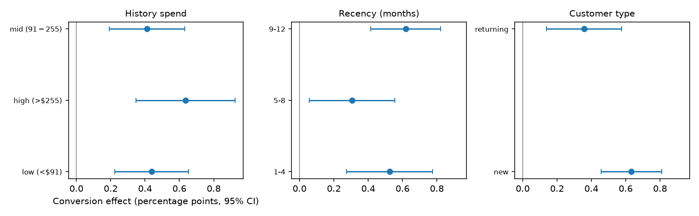

# Causal inference on a real email marketing experiment (Hillstrom RCT)

Double machine learning applied to commercial data: the Hillstrom
MineThatData email experiment — 64,000 customers randomized to a men's
email, a women's email, or no email, with two weeks of visit, conversion,
and spend outcomes. The question a marketing team actually asks: *what did
the emails cause, per customer, and for whom did they work?*

Data provenance and verification: [data/SOURCE.md](data/SOURCE.md).
Full numeric output: [outputs/results.json](outputs/results.json);
run log: [RUN_LOG.txt](RUN_LOG.txt).

## Design

- **Treatment arms:** Mens E-Mail (n = 21,307), Womens E-Mail (n = 21,387),
  No E-Mail control (n = 21,306).
- **Outcomes:** `conversion` (bought within two weeks), `spend` ($).
  Control baseline: 0.57% conversion, $0.65 mean spend — most customers
  buy nothing, so effects live in the tail.
- **Covariates (all pre-treatment):** recency, history spend and segment,
  mens, womens, zip code, newbie, channel.

## Methods

1. **ITT benchmark.** Difference in means per arm vs control with 95% CIs.
   In a randomized trial this is unbiased by construction; it is the
   number every fancier method must reproduce.
2. **Double ML.** Partially linear model for any-email vs no-email,
   5-fold cross-fitting, gradient-boosting nuisance models for
   E[Y|X] and the propensity E[W|X] (sklearn `HistGradientBoosting`).
   An AIPW estimator with the same cross-fitting is run as a cross-check.
3. **CATE by segment.** Within-segment difference in means (valid under
   randomization) across pre-treatment segments: history-spend terciles,
   recency bands, new vs returning customers.
4. **E-value.** Sensitivity of the conversion effect to unmeasured
   confounding, reported with its randomized-design caveat below.

## Headline results

| Estimand | Conversion effect | Spend effect |
|---|---|---|
| ITT, men's email vs control | +0.68 pp [0.50, 0.86] | +$0.77 [0.49, 1.05] |
| ITT, women's email vs control | +0.31 pp [0.15, 0.47] | +$0.42 [0.17, 0.68] |
| ITT, any email vs control | +0.50 pp [0.35, 0.64] | +$0.60 [0.38, 0.82] |
| Double ML, any email | +0.50 pp [0.36, 0.64] | +$0.60 [0.38, 0.82] |
| AIPW cross-check, any email | +0.50 pp [0.36, 0.64] | +$0.59 [0.37, 0.81] |

Double ML and AIPW land on top of the ITT benchmark to two decimal
places. That is the expected result under randomization — covariate
adjustment has no confounding to remove — and it is the point of running
them here: the same pipeline, validated where the truth is known by
design, is the one to trust on observational marketing data where it is
not.

**Where the effect concentrates.** The largest conversion effect is in
the high history-spend tercile (>$255 past-year spend): +0.64 pp
[0.35, 0.93]. New customers respond almost as strongly on conversion
(+0.63 pp [0.46, 0.81]) and show the largest spend effect of any segment,
+$0.85 per customer [0.57, 1.12]. The men's email outperforms the
women's email on this customer file on both outcomes.



**Sensitivity.** The any-email conversion risk ratio is 1.87, giving an
E-value of 3.14 (2.43 for the confidence limit nearest the null): an
unmeasured confounder associated with both treatment and conversion by
a risk ratio of ~3.1 each could explain the effect away. In this dataset
that is a benchmark, not a worry — assignment was randomized, so
unmeasured confounding is ruled out by design.

**Business translation.** Per 1,000 customers emailed: **+4.96
incremental conversions [3.55, 6.36] and +$597 incremental revenue
[$376, $817]**. `spend` is revenue, not profit; the dataset has no cost
data, so net gain is the revenue figure times the retailer's gross
margin (≈ $298 per 1,000 at an illustrative 50% margin), against a
near-zero marginal cost per email sent.

## Limitations

- One retailer, one campaign, spring 2008; absolute dollar effects do
  not transport to other lists or years.
- Spend is zero-inflated and heavy-tailed — a small number of large
  orders drives the spend estimates, hence the wide CIs. Segment-level
  spend effects for returning customers and the 5–8 month recency band
  have CIs that cross zero.
- Segment CATEs are subgroup average effects from stratified
  randomization checks, not individual-level effect estimates; no
  multiplicity adjustment across segments.
- Two-week outcome window only; no long-term or unsubscribe/harm
  outcomes are in the data, so "email everyone" is not a supported
  conclusion — only the average incremental effect is.

## Reproduce

```bash
python3 -m venv .venv && .venv/bin/pip install -r requirements.txt
.venv/bin/python src/analysis.py   # writes outputs/ and prints results
```

## Resume bullet

> Estimated the causal effect of email marketing on 64,000 randomized
> customers using cross-fitted double machine learning, validated
> against the randomized ITT benchmark; emailing produced +5.0
> incremental conversions and +$597 revenue per 1,000 customers
> (95% CI $376–$817), concentrated in high-history-spend and new
> customers.
